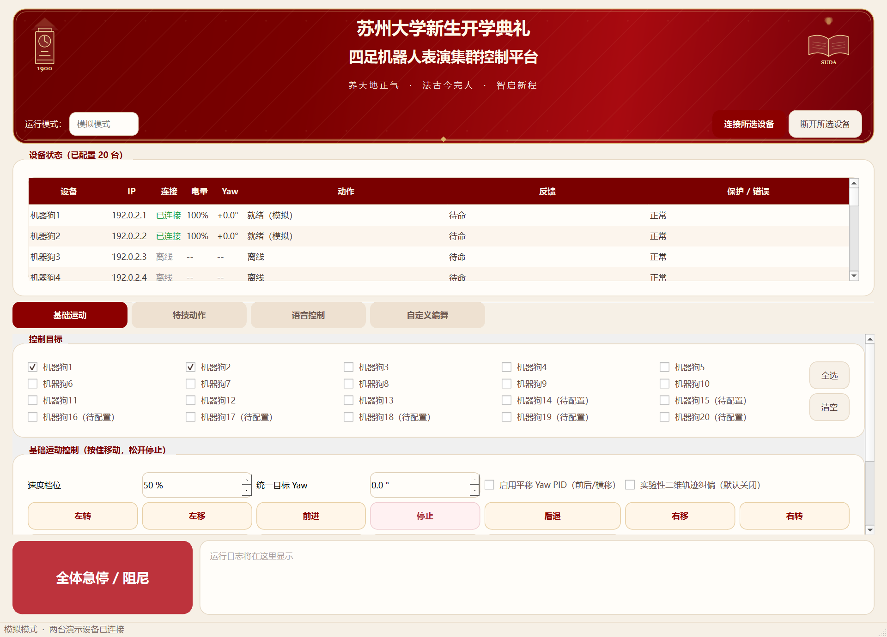

# Soochow Quadruped Fleet Control

> PySide6 · Multi-robot choreography · Telemetry and feedback · Soochow University opening ceremony

A desktop console demonstrated at Soochow University's opening ceremony. It schedules choreography across multiple quadrupeds, displays telemetry, and applies heading and speed corrections. The public demo runs with simulated robots and standard Python dependencies.

[Run the demo](#启动) · [Architecture](docs/ARCHITECTURE.md) · [Sample choreography](config/demo-choreography.json)



| Evidence | What it covers |
| --- | --- |
| Opening ceremony demonstration | Field use of the Soochow-themed console |
| Two-robot simulation | Connection, movement, stop, and a complete demo timeline |
| 259 offline tests | Scheduling, feedback, simulated control, and mocked SDK calls |

Hardware operation loads the vendor SDK and site configuration from a separate local installation.

## 苏州大学四足机器人群控系统

基于 Python 和 PySide6 的桌面控制台，保留苏大开学典礼主题。支持多机控制、状态监控、多轨编舞、航向与速度反馈、定位与现场诊断。模拟模式使用软件设备模型，可在没有机器人和 BPX SDK 的环境中演示。

## 启动

Windows 64 位，Python 3.11 或更高版本。

| 模式 | 本机双击入口 | PowerShell |
| --- | --- | --- |
| 模拟 | 启动模拟.cmd | ./start.ps1 |
| 真机 | 启动真机.cmd | ./start.ps1 -Real |

首次从 GitHub 克隆时，运行 `powershell -ExecutionPolicy Bypass -File .\setup.ps1` 创建环境并安装依赖。之后双击 **启动模拟.cmd**，在界面只勾选 dog01、dog02，点击“连接所选设备”。可以试基础运动，或加载 [演示编舞](config/demo-choreography.json) 查看两台模拟机器人的动作调度。

也可在已经安装依赖的 Python 环境中直接运行 `python -m dual_dog`。命令附加 `--check` 会验证依赖和配置后退出。

## 真机配置

1. 将有权使用的 BPX SDK 1.0.9 对应 Windows wheel 放在 `_local/sdk/bpx_sdk_open/wheelhouse/`。
2. 将真机设备配置放在 `_local/config/robots.json`，设置 `mode` 为 `real`。同目录下的 `odometry.json` 和 `positioning.json` 保存里程计标定及 UWB 场地配置。示例配置在 [config](config)，其中 IP 为演示地址。
3. 环境需要重建时执行 `./setup.ps1 -Real`。用 `./start.ps1 -Real -Check` 验证配置和 SDK 导入。通过后用 **启动真机.cmd** 启动。
4. 核对当前机器狗地址和场地，勾选安全确认，手动选择并连接设备。启动界面时设备保持未连接。现场编舞可从 `_local/config/` 加载，相对音乐路径以编舞 JSON 所在目录解析。

如需启用语音，复制 `.env.example` 到 `_local/.env` 并填写自己的 DashScope 密钥。网络诊断位于真机模式，路由管理密码在界面输入。

## 开发入口

| 位置 | 职责 |
| --- | --- |
| [dual_dog/app.py](dual_dog/app.py) | 启动参数、配置选择、真机 SDK 检查 |
| [dual_dog/ui](dual_dog/ui) | Qt 主窗口、编舞编辑器、苏大主题、标定及网络诊断界面 |
| [dual_dog/control](dual_dog/control) | 群控和单机工作线程、编舞时间线、里程计和运动反馈 |
| [dual_dog/devices](dual_dog/devices) | 模拟驱动、真机 SDK 适配、串口定位、网络维护 |
| [voice_control](voice_control) | 语音输入、命令解析和执行 |
| [tests](tests) 与 [tools](tools) | 离线测试和开发工具 |

查看 [架构与调试说明](docs/ARCHITECTURE.md) 了解指令和状态的流向。项目保留原应用许可证和版权声明。

```powershell
$env:QT_QPA_PLATFORM = "offscreen"
.\.venv\Scripts\python.exe -m unittest discover -s tests -q
```

## GitHub 发布范围

提交上位机源码、演示配置和测试。SDK、现场设备配置、演出原始文件、诊断数据及旧项目归档存放在 Git 忽略的 `_local/`。本机虚拟环境、wheel、原生库、旧安装包及含 SDK 的 EXE 同样由 `.gitignore` 排除。
