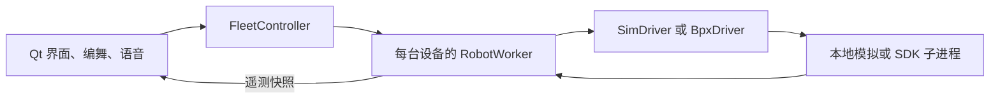

# 架构与调试

- **界面**将选择、速度和动作转成任务，读取状态快照来更新显示。
- **控制**由 FleetController 分发目标，由每台设备的 RobotWorker 串行执行。速度同步、航向和位置反馈均在驱动前计算。
- **设备**通过 RobotDriver 接口提供模拟与真机实现。真机进程通过 Pipe 接收请求并调用本机 SDK，界面线程可继续响应。
- **配置**由 app.py 选择。默认演示模式使用 config/robots.json。真机模式读取 _local/config/robots.json 和旁边的校准文件。模拟校准、诊断和新保存的编舞默认写入 _local。

## 常用调试路径

| 现象 | 优先查看 |
| --- | --- |
| 窗口能开，设备不连接 | app.py 的模式检查，ui/gui.py 的连接按钮，devices/drivers.py 的连接和遥测 |
| 设备连接但速度不如预期 | control/controller.py 的限幅与保护，control/feedback.py 和 control/speed_sync.py |
| 多轨动作时间不对 | control/choreography.py 的时间线与冲突检测，ui/gui.py 的编舞定时器 |
| 定位窗口有坐标但未回位 | devices/positioning.py 的坐标与有效期，control/controller.py 的回位条件 |

调试时先运行模拟，确认单机操作和编舞逻辑。真机联调时先检查 SDK、连接和遥测，再进行动作测试。
